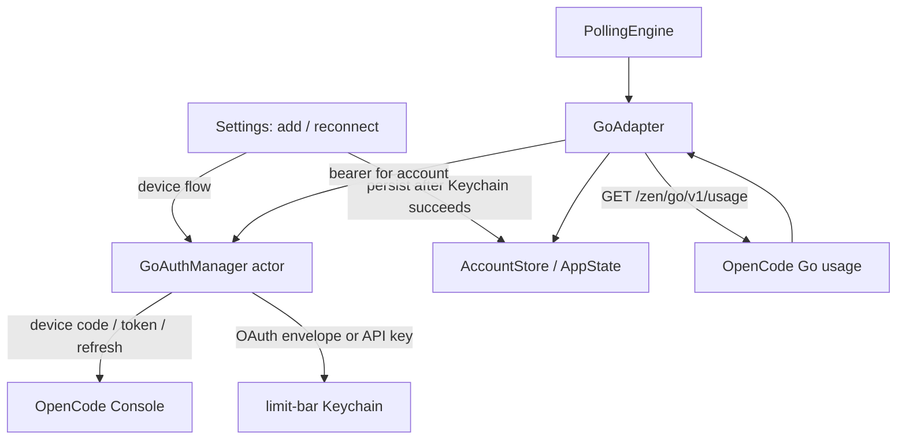

# OpenCode Go Dual Authentication Design

**Spec**: `.specs/features/opencode-go-auth/spec.md`  
**Status**: Draft

---

## Architecture Overview

Keep the provider behind `ProviderAdapter`. One actor-owned auth manager handles device authorization, Keychain persistence, API-key lookup, and serialized OAuth refresh. `GoAdapter` asks that manager for a Bearer credential, then performs the verified read-only Go usage request. Settings uses the same manager for connect/repair, but OAuth tokens remain app-owned and independent of OpenCode CLI V2.



## Code Reuse Analysis

### Existing Components to Leverage

| Component | Location | How to Use |
|---|---|---|
| Provider boundary and HTTP error mapping | `Sources/LimitBar/Providers/GoAdapter.swift` | Retain URL, parser, `ProviderError`, and stubbed `URLSession` pattern; inject credential resolution. |
| Secret storage | `Sources/LimitBar/Core/CredentialStore.swift`, `KeychainStore.swift` | Store versioned OAuth envelope and API key using the existing app Keychain service. |
| Account persistence | `Sources/LimitBar/Core/Models.swift`, `AccountStore.swift` | Add optional auth-method metadata; nil means legacy API key. |
| Settings add-account flow | `Sources/LimitBar/UI/SettingsView.swift` | Add browser/API-key selection, async progress, cancellation, and setup errors. |
| Provider status and reauth | `Sources/LimitBar/UI/PanelView.swift` | Keep last-good rendering and offer method-specific repair. |
| Network stubs | `Tests/LimitBarTests/TestSupport.swift` | Reuse `StubURLProtocol` and injected `URLSession`; extend credential fakes as required. |
| Localization | `Sources/LimitBar/Resources/{en,pt-BR,es}.lproj/Localizable.strings` | Add matching source keys in all three languages. |

### Integration Points

| System | Integration Method |
|---|---|
| Console device auth | `POST https://opencode.ai/console/auth/device/code` with JSON `{client_id, supports_org_scope}`; poll `/auth/device/token`; refresh with the same client ID. |
| Go quota | `GET https://opencode.ai/zen/go/v1/usage`, Bearer credential; live OAuth returned 200 without `x-org-id`. |
| App lifecycle | Build one `GoAuthManager` in `AppDelegate` and inject the same actor into `GoAdapter` and `SettingsView`. |
| State migration | Optional account discriminator; absent value resolves to API key; leave `openCodeGo` raw value unchanged. |

## Components

### `GoAuthMethod` and `Account`

- **Purpose**: Distinguish API-key and Console OAuth accounts without persisting secrets.
- **Location**: `Sources/LimitBar/Core/Models.swift`
- **Interface**: Optional `goAuthMethod: GoAuthMethod?`; nil is treated as `.apiKey` for old JSON.
- **Dependencies**: None.
- **Reuses**: Existing Codable `Account`/`AppState` persistence.

### `GoOAuthCredential` and `GoCredentialVault`

- **Purpose**: Encode API-key lookup and OAuth token-envelope lifecycle in the app Keychain.
- **Location**: `Sources/LimitBar/Core/GoCredentialVault.swift` (new).
- **Interface**: Store/read API key, store/read OAuth tokens by account UUID, and delete canonical/legacy/API/OAuth items.
- **Dependencies**: `CredentialStore`.
- **Reuses**: Existing Keychain service `limit-bar`; API-key names `go.api-key.<uuid>` and legacy bare UUID.

### `GoOAuthClient`

- **Purpose**: Execute the Console device-code, token-poll, and refresh HTTP protocol.
- **Location**: `Sources/LimitBar/Providers/GoOAuthClient.swift` (new).
- **Interface**: Request a device challenge, poll until approval/cancel/expiry, and refresh a token pair.
- **Dependencies**: Injected `URLSession` and deterministic clock/sleep seams for tests.
- **Reuses**: Foundation networking and URLSession stubbing from `TestSupport.swift`.

### `GoAuthManager`

- **Purpose**: Orchestrate app-owned authorization and return the correct Bearer token to the adapter.
- **Location**: `Sources/LimitBar/Core/GoAuthManager.swift` (new).
- **Interface**: Authorize an account, resolve a valid Bearer token, reauthenticate, and remove local credentials.
- **Dependencies**: `GoOAuthClient`, `GoCredentialVault`.
- **Concurrency**: Actor with per-account in-flight refresh coalescing; persist the rotated token pair before returning its access token.
- **Reuses**: Existing `CredentialStore` seam and polling-adapter injection.

### `GoAdapter`

- **Purpose**: Fetch and parse current usage for either API-key or OAuth account.
- **Location**: `Sources/LimitBar/Providers/GoAdapter.swift`.
- **Interface**: Existing `ProviderAdapter.fetchUsage(for:)`, with injected auth-manager seam.
- **Dependencies**: `GoAuthManager`, `URLSession`.
- **Reuses**: Existing official URL, percent clamp, fractional ISO-8601 parsing, and error mapping.

### Settings and reauthentication UI

- **Purpose**: Offer browser-first/API-key setup, progress/cancel/error states, method-specific repair, and local-disconnect warning.
- **Location**: `Sources/LimitBar/UI/SettingsView.swift`, `PanelView.swift`, and all three localized strings tables.
- **Dependencies**: Shared `GoAuthManager` and SwiftUI `OpenURLAction`.
- **Reuses**: Existing Add Account sheet, SecureField, unauthorized state, and cache-preserving `AccountStore` behavior.

## Data Models

```swift
enum GoAuthMethod: String, Codable, Sendable {
    case apiKey
    case consoleOAuth
}

struct GoOAuthCredential: Codable, Sendable {
    var accessToken: String
    var refreshToken: String
    var expiresAt: Date
    var workspaceID: String?
}
```

- Persist only `GoAuthMethod` in `Account`; optional nil maps to `.apiKey` for old state.
- Persist `GoOAuthCredential` as a versioned JSON envelope in a namespaced Keychain item per account. Do not write it to `AppState` or a disk file.
- API keys remain in their current Keychain item. OAuth uses `go.oauth.<uuid>`.
- Compute `expiresAt = now + expires_in`; refresh when expiry is at or within 60 seconds.
- Keep `workspaceID` as token metadata for account identity; live quota access does not require `x-org-id`.

## Error Handling Strategy

| Error Scenario | Handling | User Impact |
|---|---|---|
| Device-code request/response invalid or non-200 | Typed OAuth setup error; no account is persisted | Localized retry guidance. |
| Untrusted verification URI | Reject before `openURL` | No browser navigation to an untrusted host. |
| User code pending/slow down | Poll at server interval; add 5 seconds for `slow_down` | Show code and progress; allow cancel. |
| Keychain write fails | Do not persist account; preserve prior credential if refresh write fails | Show local storage error. |
| Refresh token revoked/invalid grant | Map to unauthorized and stop retrying the consumed token | Preserve cache and offer reconnect. |
| Usage endpoint 401/403, 429, other status | Existing `ProviderError` mapping | Reauth, backoff, or network error. |
| Account removal cleanup fails | Keep account visible and show cleanup failure; disclose local-only semantics | User can retry rather than believing disconnect completed. |

## Risks & Concerns

| Concern | Location (file:line) | Impact | Mitigation |
|---|---|---|---|
| OAuth refresh tokens are single-use and actor methods can re-enter at `await` | New `GoAuthManager` | Concurrent polls could invalidate a valid session | Coalesce in-flight refresh per account and test concurrent requests. |
| UI currently ignores Keychain write errors and deletes only legacy key | `SettingsView.swift:121–134` | False-success accounts and orphaned secrets | Route writes/deletes through tested vault; surface failure. |
| Legacy `Account` JSON has no auth-method field | `Models.swift:47–53` | Decode failure could discard saved accounts | Optional field, legacy API-key default, regression fixture. |
| CLI V2 and Console docs have different auth storage/flows | Docs and `GoAdapter.swift` | Copying CLI session may log out the user or break scope | Separate device flow; no CLI DB/Keychain reads. |
| Endpoint schema is only partially documented | `GoAdapter.swift:56–83` | Payload drift could look like 0% | Fixture based on verified shape; missing windows parse as error; preserve cache. |
| No remote session revocation route found | Account deletion UI | Local removal may be mistaken for server logout | Explicit confirmation copy; no unsupported call. |
| Existing `CredentialFake` does not model writes/deletes/failure | `Tests/LimitBarTests/TestSupport.swift:99–132` | Keychain partial-failure behavior untested | Extend fake for stateful set/get/delete and injected errors. |

## Tech Decisions

| Decision | Choice | Rationale |
|---|---|---|
| Account discriminator | Optional Codable `GoAuthMethod`, nil means API key | Backward-compatible with stored state. |
| OAuth session | App-owned Console device flow | Supported by official docs and live verified against usage; never reuse CLI token. |
| Refresh serialization | Actor with per-account in-flight task/result | Refresh token is one-use and polling may overlap. |
| Token persistence | One versioned Keychain envelope per OAuth account | Keep access/refresh pair consistent and outside app state. |
| Browser URI validation | HTTPS plus exact `opencode.ai` host | Prevent untrusted authorization navigation. |
| Remove behavior | Delete local credentials, warn no remote revocation | Official revocation route is undocumented. |
| Project decision | AD-008 narrows AD-004 for OpenCode Go only | Other providers retain the no-in-app-OAuth rule. |
